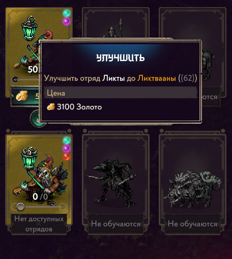
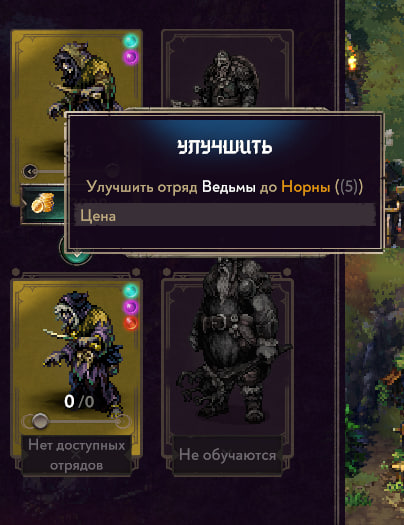

# Songs of Conquest — независимое Game QA-тестирование

**Игра:** Songs of Conquest  
**Объект тестирования:** система найма и улучшения юнитов фракции Ваниры  
**Платформа:** PC, Windows 11  
**Версия игры:** 1.10.4  
**Локализация:** русская  
**Формат работы:** самостоятельный учебно-практический QA-проект

## 1. О проекте

Самостоятельный проект по тестированию системы найма и улучшения юнитов фракции Ваниры в игре *Songs of Conquest*.

Цель работы - проверить корректность основных игровых сценариев, переходов между состояниями системы, интерфейса улучшения юнитов и связанных операций.

Тестирование проводилось независимо, без участия в разработке игры и доступа к внутренней документации разработчиков.

## 2. Подход к тестированию

В рамках проекта были подготовлены и использованы:

- **Test Plan** - определение Scope, Out of Scope, рисков и критериев завершения тестирования.
- **Checklist** - функциональные проверки системы найма и улучшения юнитов.
- **Test Cases** - тестовые сценарии с предусловиями, шагами и ожидаемыми результатами.
- **State Transition Scenarios** - проверки переходов между состояниями системы.
- **Exploratory Testing** - исследование игрового поведения за пределами основных сценариев.
- **Bug Report** - документирование обнаруженного дефекта со сравнительными скриншотами.
- **QA Summary** - итоговый отчёт о проведённом тестировании.

## 3. Результаты тестирования

| Показатель | Результат |
|---|---|
| Всего выполнено проверок | 26 |
| Успешно (Pass) | 25 |
| Неуспешно (Fail) | 1 |
| Зарегистрировано дефектов | 1 |

## 4. Обнаруженный дефект: BUG-001

**Проблема:** во всплывающей подсказке улучшения Ведьм до Норн отсутствуют стоимость улучшения и иконка золота.

Дефект обнаружен при тестировании русской локализации игры.

Для него подготовлен Bug Report с условиями воспроизведения, ожидаемым и фактическим результатами.

В качестве доказательств представлены сравнительные скриншоты проблемной подсказки и корректно работающего аналогичного интерфейса у другого типа юнитов.

**Severity:** Minor  
**Priority:** Low  
**Воспроизводимость:** Always (в проверенных условиях)

### Сравнение интерфейса

| Корректное отображение - Ликты | BUG-001 - Ведьмы → Норны |
|:---:|:---:|
|  |  |

## 5. Исследовательское тестирование

Дополнительно исследовалась реакция системы найма и улучшения юнитов на двойные нажатия, удержание кнопки мыши и последовательные действия пользователя.

В рамках выполненной исследовательской сессии дополнительных дефектов не обнаружено.

## 6. Область и ограничения тестирования

Тестирование ограничено:

- фракцией Ваниры;
- PC-версией игры 1.10.4;
- русской локализацией;
- выбранными сценариями найма и улучшения юнитов.

Полученные результаты не распространяются на всю игру, другие фракции и непроверенные версии.

## 7. Документация и доказательства

### Тестовая документация

- [Test Documentation](documents/01_SoC_Vanir_TestDocumentation.xlsx)
- [Exploratory Session](documents/02_SoC_Vanir_ExploratorySession.docx)
- [QA Summary](documents/03_SoC_Vanir_QASummary.docx)

## 8. Итоги

Выполненные проверки подтвердили корректную работу большинства исследованных сценариев найма и улучшения юнитов.

Обнаружено одно UI-несоответствие, для которого подготовлены Bug Report и визуальные доказательства.

Проект демонстрирует практические навыки планирования тестирования, разработки тестовой документации, выполнения проверок, исследования игрового поведения и регистрации дефектов.